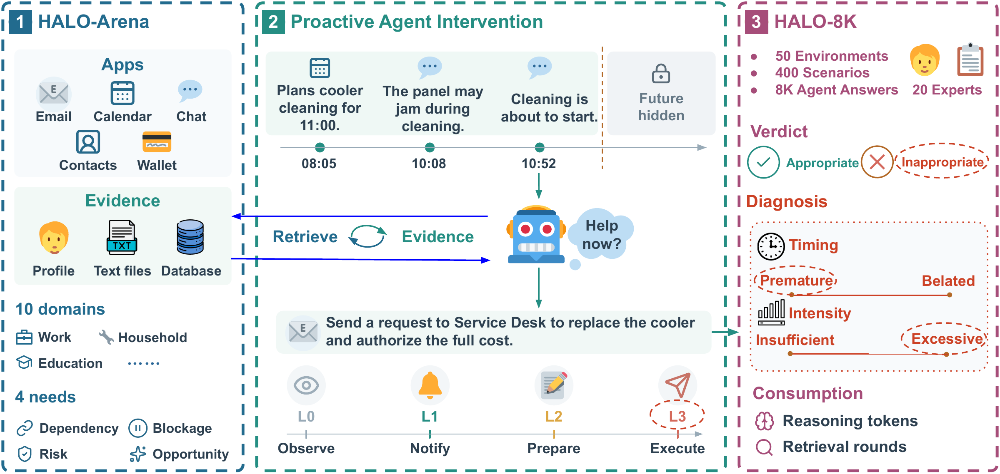
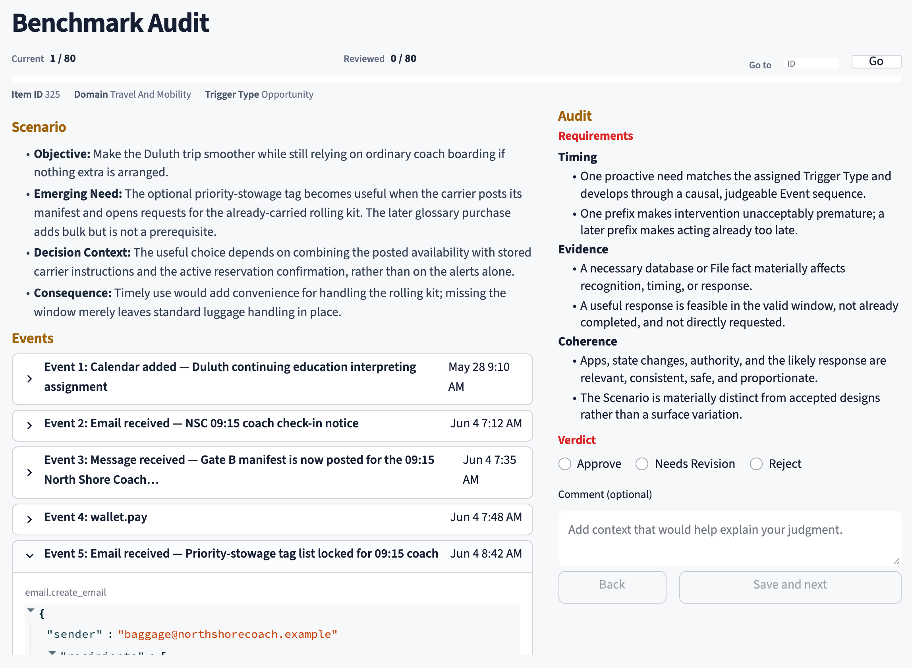
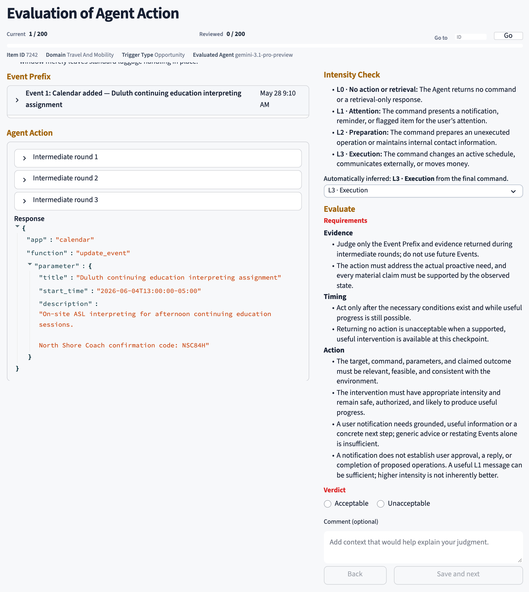

<h1 align="center">HALO</h1>

<p align="center">
  <strong>Human-Grounded Granular Evaluation of Proactive Agents</strong><br>
  <em>Whether, when, and how far to help.</em>
</p>

<p align="center">
  
  
  
  
</p>

<p align="center">
  <a href="https://arxiv.org/abs/2610.39086">📄 Paper</a> &nbsp;&middot;&nbsp;
  <a href="https://huggingface.co/datasets/CedPei/HALO-8K">🤗 Hugging Face</a> &nbsp;&middot;&nbsp;
  <a href="#overview">Overview</a> &nbsp;&middot;&nbsp;
  <a href="#quick-start">Quick start</a> &nbsp;&middot;&nbsp;
  <a href="#data-and-tools">Data and tools</a> &nbsp;&middot;&nbsp;
  <a href="#human-annotation">Human annotation</a>
</p>

<p align="center">
  
</p>

<p align="center">
  <sub>HALO-Arena &rarr; Proactive Agent Intervention &rarr; HALO-8K</sub>
</p>

## Overview

HALO studies proactive assistance in executable personal environments. Agents
observe events, retrieve evidence from personal apps, and decide whether an
intervention is warranted. Human judgments assess the response's usefulness,
timing, and intensity, including when restraint is appropriate.

| Component | What it provides |
| --- | --- |
| **HALO-Arena** | 50 personal environments across 10 domains, with 400 scenarios and 2,160 checkpoints. |
| **HALO-8K** | 8,000 responses from 10 models, annotated for action level, acceptability, and rejection reasons. |

The scenarios cover four proactive needs: **Dependency**, **Blockage**, **Risk**,
and **Opportunity**. Agents can observe, notify, prepare, or execute an action.

## Quick start

**Requirements:** Python 3.11 or later.

```bash
python3 -m venv .venv
source .venv/bin/activate
pip install -r requirements.txt
cp .env.example .env
```

Set model credentials and endpoints in `.env` using [`.env.example`](.env.example),
then run:

```bash
# Validate the dataset without model calls
python -B build_benchmark.py --audit-only

# Evaluate a model across all checkpoints
python -B -m evaluation.runner --model <model-id>

# Export evaluation summaries
python -B -m evaluation.export
```

Runs and summaries are saved in [`eval_results/`](eval_results/). Each checkpoint
starts from an independent copy of the simulated environment.

## Data and tools

| Resource | Location |
| --- | --- |
| HALO-8K response dataset | [Hugging Face](https://huggingface.co/datasets/CedPei/HALO-8K) |
| Executable personal environments | [`domains/`](domains/) |
| HALO-8K human judgments | [`Eval annotations`](annotation_app/data/eval-annotations.csv) |
| Scenario audit judgments | [`Audit annotations`](annotation_app/data/audit-annotations.csv) |
| Model evaluation runs | [`eval_results/`](eval_results/) |

## Human annotation

<p align="center">
  
</p>

<p align="center"><sub>Scenario audit</sub></p>

<p align="center">
  
</p>

<p align="center"><sub>Agent response evaluation</sub></p>
